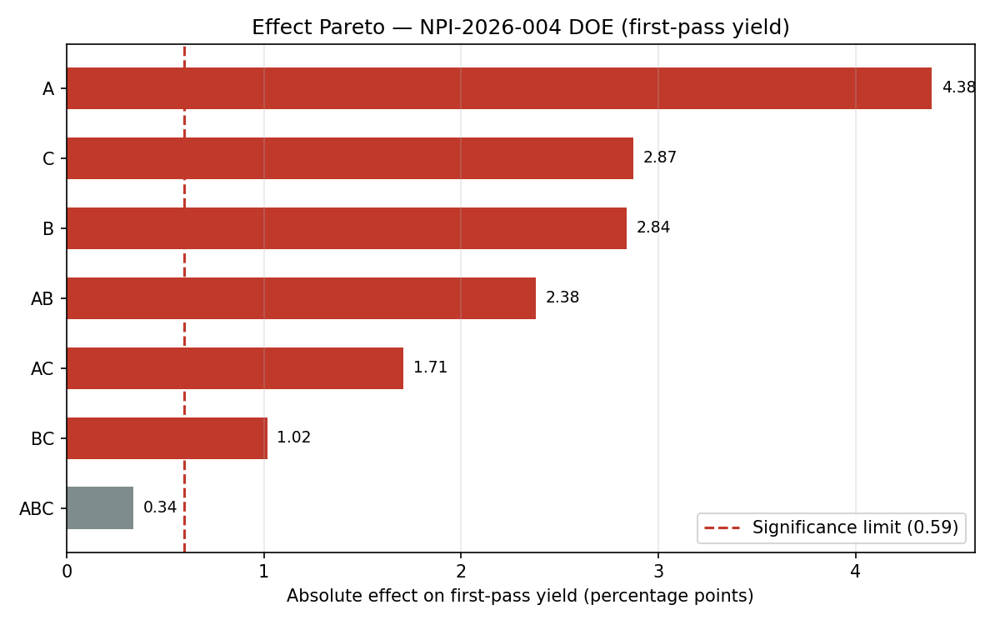
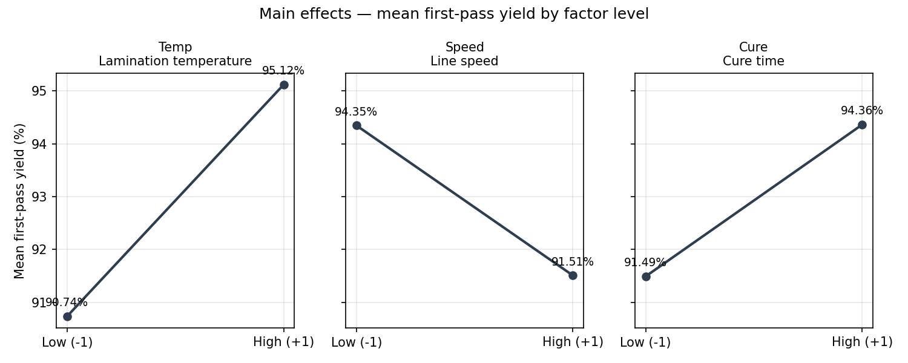
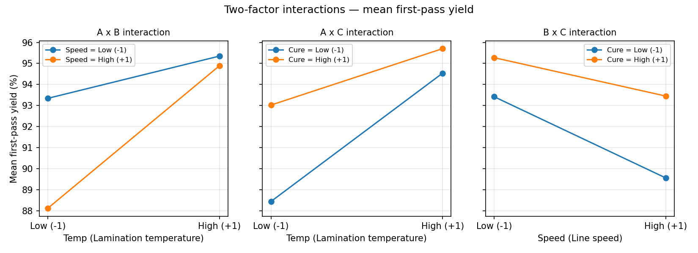
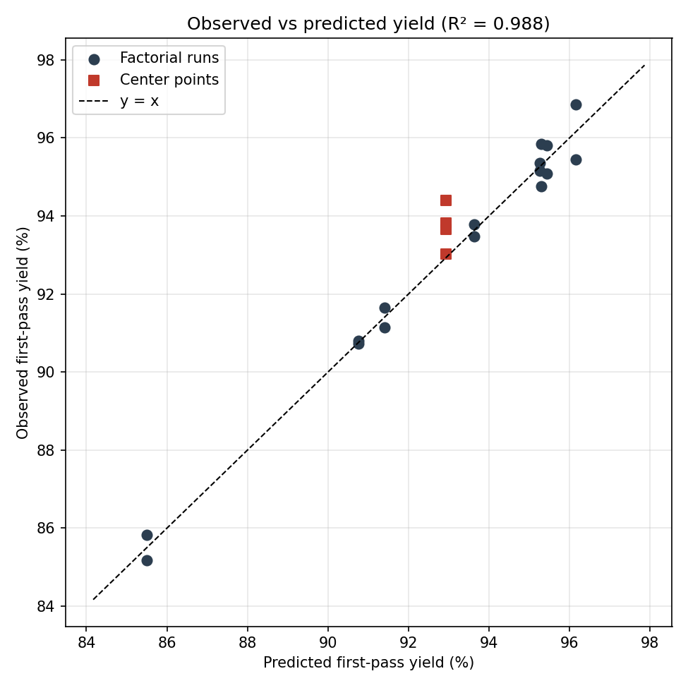

# NPI Trial Report — Trial NPI-2026-004

2^3 full-factorial DOE: lamination temperature x line speed x cure time, with 4 center points and 2 replicates (20 runs total, randomized run order, seed 42).

> **Synthetic data disclaimer:** all data in this report was generated synthetically for a portfolio project. It is not Tesla production data and must not be used for real process decisions.

## Recommendation: CONDITIONAL GO

Predicted best-setting yield of 96.15% clears the 95% target and 3 main effect(s) are significant, but the curvature test is significant (p = 0.024): the center points averaged 93.72% against a factorial mean of 92.93%, so the response surface is not flat in the middle of the design space. Confirm the optimum with the planned axial-point follow-up before full scale-up.

## Design summary

| Factor | Low (-1) | Center (0) | High (+1) | Unit |
| --- | --- | --- | --- | --- |
| Lamination temperature (A) | 150.0 | 160.0 | 170.0 | degC |
| Line speed (B) | 8.0 | 10.0 | 12.0 | m/min |
| Cure time (C) | 30.0 | 37.5 | 45.0 | min |

- Runs: 8 corner treatments x 2 replicates + 4 center points = 20 runs
- Responses: first-pass yield (%) and defect count per 200 units
- Overall mean yield: 93.09% (factorial mean 92.93%, center mean 93.72%)
- Model R² (factorial runs): 0.988

## Effects (Yates algorithm)

Effect = change in first-pass yield when the factor moves from its low (-1) to high (+1) level. Significance at alpha = 0.05.

| Effect | Estimate | SE | t | p | Significant |
| --- | --- | --- | --- | --- | --- |
| A | 4.384 | 0.270 | 16.225 | 0.000 | Yes |
| B | -2.839 | 0.270 | -10.507 | 0.000 | Yes |
| AB | 2.379 | 0.270 | 8.804 | 0.000 | Yes |
| C | 2.871 | 0.270 | 10.627 | 0.000 | Yes |
| AC | -1.706 | 0.270 | -6.315 | 0.000 | Yes |
| BC | 1.016 | 0.270 | 3.761 | 0.003 | Yes |
| ABC | 0.339 | 0.270 | 1.254 | 0.236 | No |

Significant effects: A, B, AB, C, AC, BC.

## ANOVA (first-pass yield)

| Source | SS | df | MS | F | p |
| --- | --- | --- | --- | --- | --- |
| A | 76.869 | 1 | 76.869 | 263.26 | 0.0000 |
| B | 32.234 | 1 | 32.234 | 110.40 | 0.0000 |
| AB | 22.634 | 1 | 22.634 | 77.52 | 0.0000 |
| C | 32.976 | 1 | 32.976 | 112.94 | 0.0000 |
| AC | 11.645 | 1 | 11.645 | 39.88 | 0.0001 |
| BC | 4.131 | 1 | 4.131 | 14.15 | 0.0031 |
| ABC | 0.459 | 1 | 0.459 | 1.57 | 0.2359 |
| Curvature | 2.007 | 1 | 2.007 | 6.87 | 0.0238 |
| Pure error | 3.212 | 11 | 0.292 | -- | -- |
| Total | 186.167 | 19 | -- | -- | -- |

Pure-error df = 11, MS error = 0.292. Curvature p = 0.0238.

## Predicted best setting

- Lamination temperature: 170 degC (High (+1))
- Line speed: 12 m/min (High (+1))
- Cure time: 45 min (High (+1))
- Predicted first-pass yield: **96.15%**
- Predicted defects per 200 units: **7.0**

## Charts

## Next steps

1. Hold scale-up until the conditional items above are closed out and the follow-up data is reviewed.
2. Run the planned axial-point follow-up (trial NPI-2026-005) around the best setting to confirm the optimum is not on a boundary.
3. Do not lock the best setting into the manufacturing instructions until the axial follow-up confirms it.
4. Keep production on the current approved settings and track first-pass yield weekly against the 93% floor in the meantime.
5. Hold the second-source lamination film trial (NPI-2026-010) until the DOE best setting is confirmed.

## Data

- `data/doe_runs.csv` — one row per DOE run (run order, coded and actual factor levels, yield, defect count).
- `data/trial_log.csv` — NPI trial log (trial ID, date, line, engineer, objective, status, observations).
- Reproduce with: `python npi_doe.py --generate` then `python npi_doe.py --analyze`.
